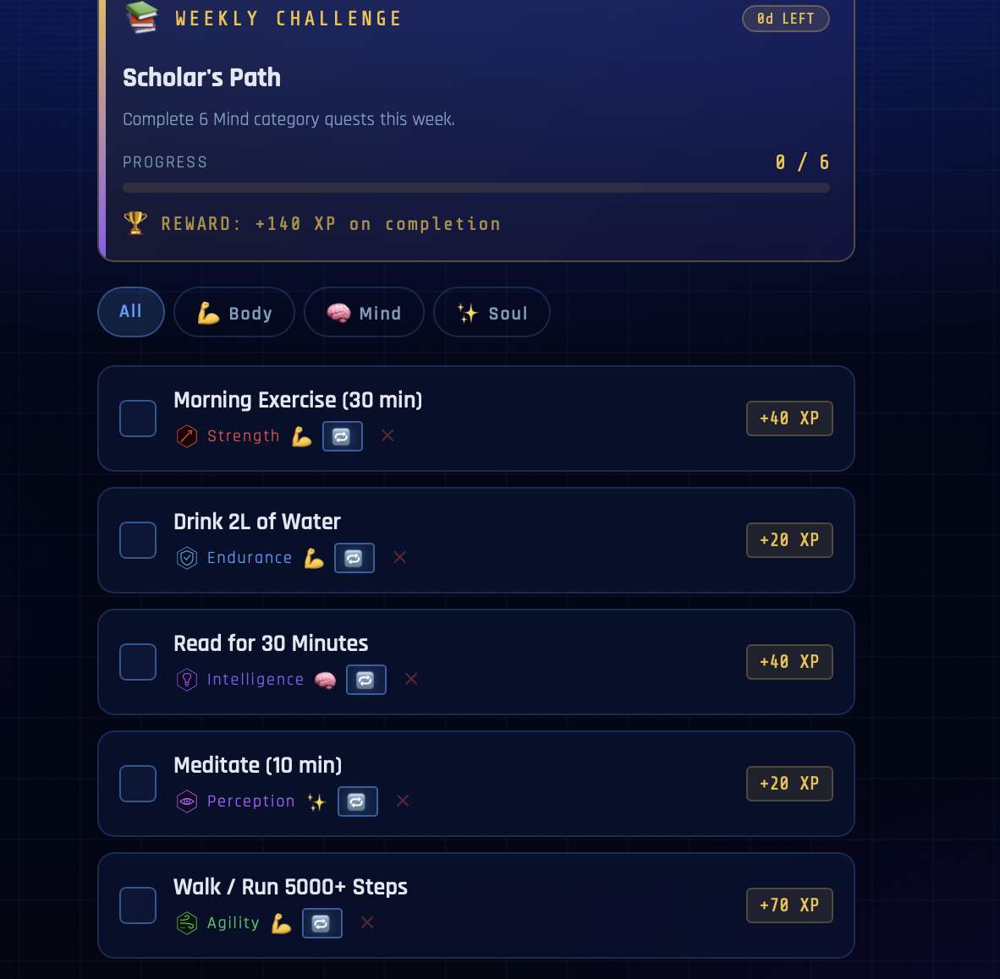
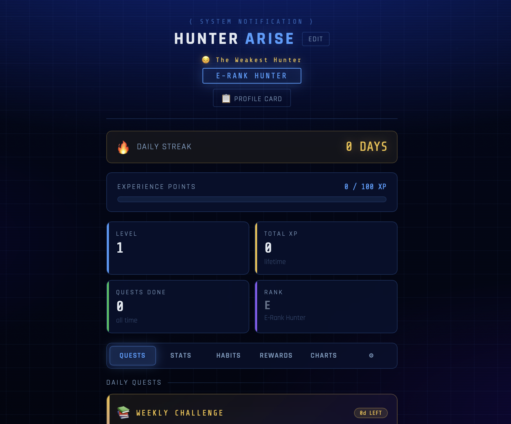
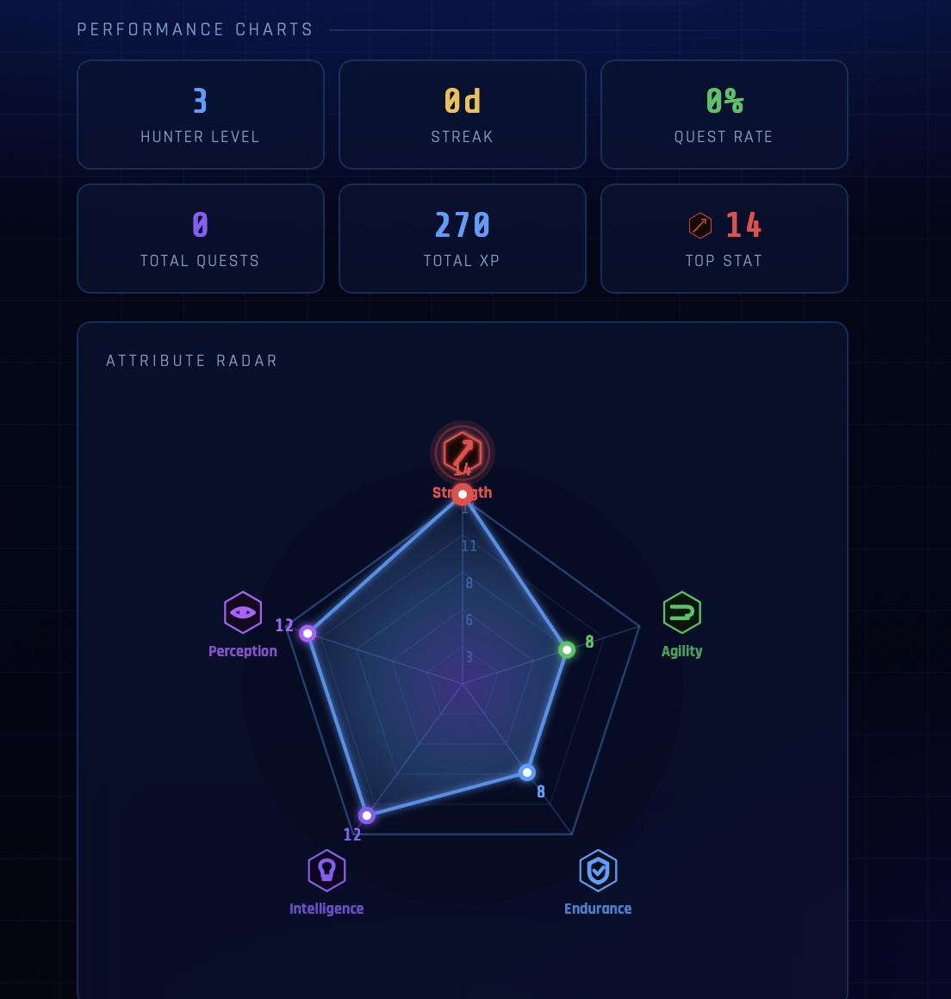

# ⚔️ Hunter System

A Solo Leveling-inspired RPG habit tracker. Turn your daily habits into quests, earn XP, level up, and rise from the weakest to the strongest.

**▶️ Live app:** https://YOUR-USERNAME.github.io/YOUR-REPO/

> **Disclaimer:** This is an unofficial, non-commercial fan project. It is not affiliated with, endorsed by, or sponsored by the creators or publishers of *Solo Leveling*. All rights to the original series belong to their respective owners.

---

## 📸 Screenshots

| Dashboard | Status | Charts |
|-----------|--------|--------|
|  |  |  |

*(Add your screenshots to a `screenshots/` folder and update the filenames above.)*

---

## ✨ Features

- **Quests:** turn daily habits into quests and complete them for XP
- **XP and leveling:** level up as you stay consistent
- **Attribute stats:** grow STR, VIT, INT, AGI and PER based on the habits you complete
- **Streaks:** keep your daily chain alive
- **Achievements and titles:** unlock them as you progress
- **Shadow Monarch arc:** a special storyline that unlocks at level 50
- **Multiple themes:** pick the look that fits you
- **Charts:** radar, bar and donut charts to visualize your growth
- **Works offline:** installable as a PWA, no account or server needed
- **Private by design:** all data is stored locally in your browser

---

## 🚀 Getting Started

### Use it online
Open the live link above in any modern browser.

### Install it as an app
- **Desktop (Chrome / Edge):** click the install icon in the address bar
- **Android (Chrome):** menu → *Add to Home screen* / *Install app*
- **iOS (Safari):** Share → *Add to Home Screen*
- **Mac (Safari):** File → *Add to Dock*

### Run it locally
```bash
git clone https://github.com/YOUR-USERNAME/YOUR-REPO.git
cd YOUR-REPO
# Option 1: just open index.html in your browser
# Option 2: serve it (needed for the service worker / install)
python3 -m http.server 8000
# then visit http://localhost:8000
```

---

## 💾 Your Data

Everything is saved in your browser's `localStorage`. Nothing is sent to any server. Clearing your browser data will erase your progress, so back up if you switch devices.

---

## 🛠️ Tech

Plain HTML, CSS and JavaScript in a single self-contained file, with a service worker for offline support. No frameworks and no build step.

---

## 🗺️ Roadmap

- [ ] Anime-style STATUS screen
- [ ] More themes and achievements
- [ ] Data export / import

---

## 🤝 Contributing

Ideas and bug reports are welcome. Open an [issue](../../issues) or submit a pull request.

---

## 📄 License

The code in this repository is released under the [MIT License](LICENSE). Solo Leveling names, characters and related IP remain the property of their respective owners and are not covered by this license.

---

Made by **Noor**
